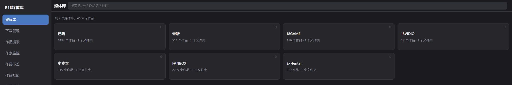
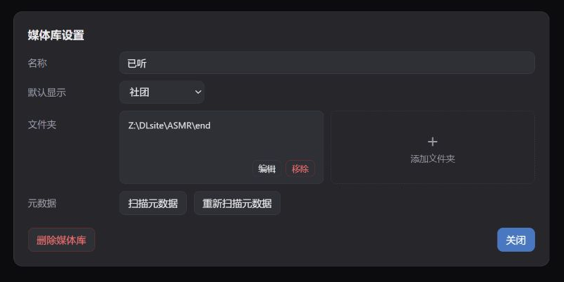
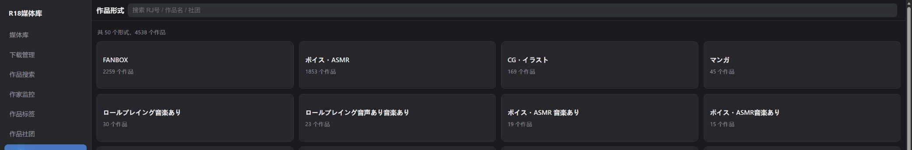
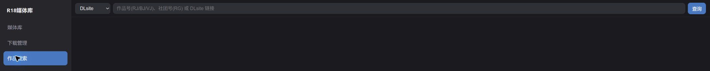
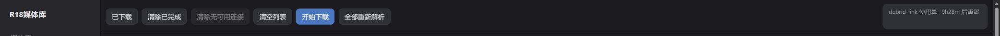
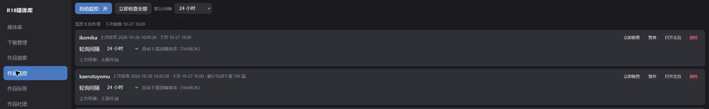

# R18 Media Library — User Manual

[简体中文](使用手册.md) · [日本語](使用手册.ja.md) · **English**  
[README](README.en.md) · [Visual showcase](系统展示.en.md)

Project: R-18MediaLibrary, formerly DLsiteMedia.  
Checked: 2026-10-26.  
Based on the repository source and the actual Web interface opened in Edge. Names, counts, creators and tasks in screenshots are examples from an existing installation, not defaults. Downloads, moves, deletion, account login and game launching were not performed while writing this manual; their procedures and effects were checked in source. Screenshots retain the actual Chinese UI. English labels below describe the controls; Chinese labels are included where useful for locating them.

## Contents

1. [Desktop and Web](#1-desktop-and-web)
2. [Installation, startup and initial settings](#2-installation-startup-and-initial-settings)
3. [Create libraries and import local works](#3-create-libraries-and-import-local-works)
4. [Browse, search and categories](#4-browse-search-and-categories)
5. [Work details, favorites and file management](#5-work-details-favorites-and-file-management)
6. [Images, audio and video](#6-images-audio-and-video)
7. [DLsite and Anime-sharing downloads](#7-dlsite-and-anime-sharing-downloads)
8. [asmr.one direct downloads](#8-asmrone-direct-downloads)
9. [FANBOX archive and official sources](#9-fanbox-archive-and-official-sources)
10. [E-Hentai and pixiv](#10-e-hentai-and-pixiv)
11. [Queue, extraction and history](#11-queue-extraction-and-history)
12. [Work monitoring](#12-work-monitoring)
13. [Account access](#13-account-access)
14. [Settings and cover hosting](#14-settings-and-cover-hosting)
15. [Web access and portal login](#15-web-access-and-portal-login)
16. [Games and remote streaming](#16-games-and-remote-streaming)
17. [Current image-translation scope](#17-current-image-translation-scope)
18. [Backup, migration and troubleshooting](#18-backup-migration-and-troubleshooting)

## 1. Desktop and Web

R18 Media Library consists of a Windows application and an embedded Web service. The application manages the database, disk files, downloads, scans and local playback. The browser manages the same data through that service. Exiting the desktop process also stops the Web service, downloads and background monitoring.



| Navigation | Purpose |
| --- | --- |
| Library (媒体库) | Browse local files by library, circle and work |
| Downloads (下载管理) | Download tasks, retries and history |
| Work search (作品搜索) | Search external sources and queue downloads |
| Work monitoring (作品监控) | Check FANBOX archive creators for new posts and pixiv accounts for new bookmarks, and queue them |
| Tags / Circles / Formats (作品标签／作品社团／作品形式) | Browse imported works from different perspectives |
| Favorites (我的收藏) | Browse manually saved favorites |
| Accounts (账号访问) | FANBOX, pixiv and E-Hentai login status and credentials |
| Settings (系统设置) | Downloads, proxy, libraries, cover hosting and more |

The **?** button at the upper right of each page (or at the end of its toolbar) opens the chapter of this manual for that page; each section heading in Settings has its own **?** as well.

**Web paths refer to the computer running the desktop app.** Entering `D:\Media` from a phone means the server's D drive, not storage on the phone or browser device. Downloads also go to the server.

| Capability | Desktop | Web |
| --- | --- | --- |
| Browsing, categories, favorites, queue and creator monitoring | Supported | Supported |
| Add a library folder | System folder picker | Enter a server absolute path |
| Audio/video playback | LibVLC video, NAudio audio | Browser player; format support depends on the browser |
| asmr.one account and SOU source preference | Configure and use direct downloads | No dedicated direct-download entry currently; shared queue remains visible |
| E-Hentai site/quality; pixiv rating/matching/quality | Configurable | Uses server settings |
| External access and portal SSO | Configurable | External-access status is read-only |
| Games | Run locally | Request server execution or streaming |
| Image translation | Settings and dependency management; see section 17 | No translation control currently |

## 2. Installation, startup and initial settings

### 2.1 Run from source

Requires Windows and .NET 10 SDK. In the repository root:

```powershell
dotnet build src/R-18MediaLibrary.csproj
dotnet run --project src/R-18MediaLibrary.csproj
```

You can also double-click `start.bat`. It switches to the project directory and runs Release configuration. The first build restores dependencies.

### 2.2 Published application

Run `publish.bat` to generate `publish/R-18MediaLibrary.exe`. The script clears the old `publish` directory first, so never store your database or works there. The target computer needs .NET 10 Desktop Runtime. Keep the adjacent `libvlc/win-x64/` data directory.

### 2.3 Recommended first-use sequence

1. Confirm the cache path in Settings → Downloads.
2. Create a library and add a folder for completed works; see section 3.
3. Configure a proxy if needed and ensure the server can reach its address.
4. Configure source accounts. Anime-sharing file-host resolution needs a Debrid-Link API key; other direct-link sources do not use that relay.
5. Import existing files and verify browsing before downloading a few works.
6. Enable external access on desktop if you want phone access.

Ordinary settings usually save when a selection changes or focus leaves an input. There is no global Save settings button. Accounts instead use Save and check (保存并检测).

## 3. Create libraries and import local works

### 3.1 Create a library

1. Open Settings → Library.
2. Click New library (新建媒体库) and enter a name, such as Audio.
3. Add a folder. On Web, enter an existing absolute path on the server, such as `D:\Media\Audio`.
4. Return to the library homepage. Click a card to browse, or the `⚙` at its upper right for that library's settings.



One library can reference multiple folders. Its name is a logical group; folders are actual disk locations. Default view (默认显示) selects works or circles for the next visit.

### 3.2 Directory layout

Scanning examines only **immediate child folders** of a source directory. Folder names must contain `RJ` followed by at least six digits, or `FB`, `EH` or `PX` followed by digits.

```text
D:\Media\
├─ RJ123456\                 DLsite work
│  ├─ DataSource\            Covers, descriptions and other app metadata
│  └─ Audio\
├─ FB12345678\               FANBOX post
├─ EH1234567\                E-Hentai gallery
└─ PX123456789\              pixiv artwork
```

For `D:\Media\Circle\RJ123456`, register the Circle folder as a source or reorganize the hierarchy. Support for RJ/BJ/VJ search does not mean the folder scanner supports BJ/VJ: the current scan pattern excludes them.

### 3.3 Scanning and metadata

| Control | Behavior | When to use |
| --- | --- | --- |
| Scan all sources (扫描全部数据源) | Scans every library that has folders, in order | Initial import or many new local works |
| Scan metadata (扫描元数据) | Scans one library, imports new folders, prunes missing records and fills required metadata | Routine synchronization |
| Rescan metadata (重新扫描元数据) | Same process, but forces metadata retrieval again | Missing or outdated fields and covers |

Wait for the completion message. You can leave and return; scans run in the background and later requests queue up. If network retrieval fails, check connectivity and retry that library.

**Scanning also prunes missing-work records.** When a source root is reachable but a work folder inside it no longer exists, that work's record is deleted. When the whole root is unreachable (a disconnected network drive, an unplugged removable drive), pruning skips it, so nothing is lost. If a work folder has only been renamed or moved temporarily, restore it before scanning.

### 3.4 Rename, change paths and remove

- **Rename:** edit the name under `⚙`. The app updates library names in works, download targets and monitoring targets.
- **Edit folder:** use after files have already moved or a drive letter changed. Enter an existing new path; the app updates stored path prefixes. It does not move the entire source directory for you.
- **Remove folder:** only detaches that source from the library configuration and changes subsequent scan scope. Works already imported from it are not deleted: they stay visible in that library, and later scans do not prune them. Delete unwanted works one by one from their detail pages.
- **Delete library:** removes the configuration. The dialog explicitly retains local files and imported work records. This differs from Delete work. Those works lose their library assignment and no longer appear under any library card, but remain reachable through homepage search and Tags / Circles / Formats.

## 4. Browse, search and categories

### 4.1 Within a library

1. Open a library card.
2. If you see circles, open one to reach its works.
3. Use Show works / Show circles (显示作品／显示社团) in the top bar to switch in place.
4. Choose an available sort option.
5. Open a work card. Back (返回) at the upper left returns one level.

### 4.2 Search existing works

Scoped searches on the homepage, inside a library, or within tag/format groups match work IDs and titles on the server. The homepage covers all libraries; a library view restricts the scope. Once inside a work list, local card filtering also includes circle names. Although the placeholder mentions circles, not every level supports circle-name queries. Use the Circles navigation entry to find a circle. Clear the field to restore the original view.

Work search in the sidebar searches external sources. Use the library top bar for imported files.

### 4.3 Categories, circles and favorites



Tags groups by tag, Circles gathers circles across libraries, and Formats groups by stored metadata. Open groups to reach works. Format labels may remain Japanese or have similar variants.

The edit control at the upper right of a circle card sets its display alias, FANBOX homepage and pawchive homepage. An alias changes presentation, not the real circle name in work records. Homepage links can be opened directly.

Favorites is maintained through each work's favorite toggle; it does not copy files.

## 5. Work details, favorites and file management

A detail page contains a title, collapsible details and work files. If the work folder exists, the description starts collapsed for faster access to files. Expand Work details (作品详情) for covers, IDs, circle, release date, tags and body text. Without a work folder it starts expanded.

Clickable tags, voice actors and series open filtered results. The work-ID link always points to a DLsite work page, so it only works for DLsite works; for FANBOX, E-Hentai and pixiv works it leads to no matching page.

| Control | Effect |
| --- | --- |
| ☆ / ★ Read (已读) | Toggles the reading marker without moving files |
| ♡ / ♥ Favorite (收藏) | Adds or removes the work from Favorites |
| Move library (移动媒体库) | Shown only when the work folder exists. Select a target library and folder; confirmation moves the actual work directory and updates records |
| Delete work (删除作品) | Deletes the work folder, database records, related download records and caches; currently not recoverable |

Before moving, check free space and open-file locks. Before deleting, check the work name. This is not a hide-only action.

The read marker, the download-history state `已品悦`, and a user-created library named “Listened” are separate concepts. In source, `已品悦` means a work is visible in the library; local import and successful extraction/import also set it. It does **not** prove the user has listened to or read the work. Do not infer reading progress from a library name or this state alone.

## 6. Images, audio and video

### 6.1 Browse files

Work files (作品文件) appears directly below details. Switch between Thumbnails (缩略图) and File list (文件列表). Thumbnails suit images; the file list shows names, sizes and a collapsible tree. Open folders in thumbnail mode, or expand directory rows in list mode.

### 6.2 Images

Click an image to open the large viewer. Web supports switching left/right; on touch devices, swipe left for next, right for previous and vertically to exit. Escape, close, clicking the background or browser Back also closes the viewer. Back closes the image first rather than leaving the work. Images at the same directory level form the viewing set; open subfolders separately.

### 6.3 Audio

Click audio to open the bottom player. Files at the same level form a name-ordered queue. Pause, select previous/next, seek or choose a track from the playlist. When more than about three seconds have played, or on the first track, Previous restarts the current track (same on both ends).

The sleep timer differs between the two ends:

- **Web:** 15 / 30 / 45 / 60 / 90-minute presets, custom minutes or Finish current track (播放完当前). **When time expires, the current track finishes and then continuation stops**; it is not cut off immediately.
- **Desktop:** 15 / 30 / 45 / 60 / 90-minute presets only. **When time expires, playback pauses immediately** and keeps its position, so you can resume at any time.

Desktop NAudio playback also normalizes loudness.

### 6.4 Video and other files

Click video to open its player. Same-level videos form a queue and continue automatically. Desktop uses LibVLC; Web depends on browser container/codec support. A file playing on desktop may not play in Edge.

Other files open their browser URL; preview versus download depends on type and browser. For `.exe`, see section 16.

## 7. DLsite and Anime-sharing downloads



### 7.1 Query

1. Open Work search and choose DLsite.
2. Enter an RJ/BJ/VJ work ID, RG circle ID or DLsite link, then Search (查询) or Enter.
3. A work opens source results; circle/catalog input opens a work grid with more results loaded below.

The current Web input does not promise arbitrary full-text title search. Prefer IDs or links above.

### 7.2 Relay setup

The forum workflow extracts file-host links and resolves them through Debrid-Link. Enter your valid API key in Settings → Debrid-Link relay (Debrid-Link 下载中转站) and use Test (测试). Supported hosts and remaining quota come from that service.

When no API key is set, the key is invalid, or premium has expired, and Free host download (网盘免费下载) is on (the default), Rapidgator and Katfile links switch to the host's own free download: a background embedded browser clicks the free-download button, waits out the countdown and passes the bot check, then the direct link downloads as usual. Free accounts get one file at a time per host with Interval (min) (下载间隔, default 120 — Rapidgator's "1 file per 120 minutes") between files; queued parts show "Free wait HH:mm" in the download list and resume on their own, so works with many parts take a while. Free speed is limited and cannot resume. Rapidgator free is limited to 500 MB per file (larger ones show "Premium only"); other hosts show "Host unsupported". After renewing or entering a valid key, downloads switch back to the relay within about 10 minutes.

### 7.3 Download choices

| Method | Procedure |
| --- | --- |
| Manual source | Open a thread result, wait for extraction/checking, click a valid host group and select library/folder |
| Combined download (组合下载) | Click Combined download on a thread result. It prioritizes Rapidgator and fills missing parts using same-named parts on other hosts; queues only a complete set and reports gaps |
| Per-work automatic download | Once the forum scan has found threads for the work (`AS·N帖`), click Automatic download (自动下载) on its grid card and select a target; background search, checks and resolution follow. The button is greyed out until then |
| Grid-wide automatic download | Enable the toolbar switch and select a target once; eligible works and subsequent pages are processed, potentially creating many tasks |

Cards can show pending scan, `AS·N帖`, `AS·无`, disliked, waiting, downloading, downloaded or `已品悦`. A matching thread does not prove complete or usable files. Dislike skips works you do not want processed.

Previously queued works may trigger a history notice. Check before duplicating tasks. Watch actual progress in Downloads after queuing.

## 8. asmr.one direct downloads

These instructions are for **desktop**. asmr.one serves voice/ASMR (SOU) works without Debrid-Link.

1. Enter account/password under Settings → ASMR.ONE and run Login test (登录测试).
2. Choose a mirror and file types such as mp3, flac, wav, images and subtitles.
3. Set SOU's preferred source to asmr.one in Work-type source preferences (作品类型优先搜索).
4. Search an SOU work by RJ ID.
5. Use the asmr.one direct-download banner and select a library.

With an account configured, a missing work falls back to Anime-sharing. Without account configuration the banner may still appear, but downloading requests setup; its presence does not prove availability. Direct downloads preserve nested directories.

Current Web search has no corresponding banner or call entry. Desktop-created tasks remain visible in the shared Web queue.

## 9. FANBOX archive and official sources

### 9.1 Choose the source

| Dropdown | Source | Account requirement |
| --- | --- | --- |
| FANBOX | pawchive archive | No FANBOX login required |
| FANBOX (account name) | Official fanbox.cc | Save and validate FANBOX login under Accounts first |

The official source reads only content the account may access. Sponsorship required (需赞助) means the account lacks access and download is disabled.

### 9.2 Search, preview and download

1. Choose a source and enter a creator name, ID or creator link for that source.
2. Search. The archive's first search downloads a creator index and can be slower.
3. Choose a creator if several match; a single match may open directly.
4. Click a post cover/title for text, images, attachments and supported external-file information.
5. For one post, use Download on its card or detail toolbar. For a batch, Select (选择) cards, then Download selected (下载选中).
6. Choose library/folder, check queued/skipped counts and inspect Downloads.

Select all covers currently loaded, selectable posts. Check counts after loading more. Clicking a card opens details rather than selecting it. Downloaded/in-progress posts remain viewable but cannot be selected again.

An empty official-source query lists sponsored/followed creators. Switching between archive and official sources resets the relevant data; do not mix their results.

### 9.3 Imported files

Post folders use `FB<postID>`. Images are numbered in order; attachments usually retain names with a sequence prefix. Supported external shared files are expanded into queued items. With auto-extraction enabled, archives are extracted layer by layer (archives inside archives too) and their contents are flattened into the post's root folder, without keeping intermediate extraction folders. Name clashes get `_2`, `_3` appended instead of overwriting. Archives that extract are deleted; those that cannot be opened are left in place and the post is still imported. Availability still depends on links and source support.

Browse completed posts in the shared library, not a separate local library on the search page. Monitoring is covered in section 12.

## 10. E-Hentai and pixiv

### 10.1 E-Hentai / ExHentai

1. Set site and image quality on desktop; test the connection if needed.
2. Configure Accounts when access requires login.
3. Choose E-Hentai in search and enter keywords, a tag query such as `artist:name`, or a gallery URL.
4. Open a card for details and tags; use Download / Download this gallery (下载本篇), or Select → Download selected for batches.
5. Choose a target; open `EH<galleryID>` in the library after completion.

Original quality requires source support. Without login the backend can fall back to display images. ExHentai access depends on account permissions and valid cookies.

### 10.2 pixiv

1. Configure pixiv login in Accounts as required by the content.
2. Set quality, search rating and tag-matching mode on desktop.
3. Choose pixiv; enter keywords, tags, an artwork link or ID.
4. Open details, or queue with Select/Download and Download selected.
5. Browse `PX<artworkID>` after completion.

Unauthenticated results may exclude R-18 works. Selecting pixiv does not prove valid login. A preview is not an already downloaded original; originals are fetched during download.

## 11. Queue, extraction and history



### 11.1 Start, pause and inspect

Click a work name or arrow to expand files/parts, showing progress, speed, status, error reason and Copy link (复制链接). Nested direct-link directories retain their structure.

Start downloads (开始下载) starts the engine; it becomes Pause downloads (暂停下载). Pausing (暂停中…) means shutdown is still finishing. Per-work Download/Stop controls appear as appropriate. Resuming depends on source Range support.

The settings Auto download option concerns the engine; grid Auto download creates tasks in bulk; monitoring discovers new posts periodically. They are distinct controls.

### 11.2 Retry and cleanup

| Control | Effect |
| --- | --- |
| Resolve again (重新解析) | Obtains fresh addresses for failed tasks |
| Resolve all again (全部重新解析) | Requeues failed resolution and no-link tasks; currently also starts the engine |
| Search again (重新搜索) | Appears only when there are failed tasks. After confirmation it **deletes the work folder (even if already imported), its download records and its work record (including `已品悦`)**, then returns to search. Not recoverable |
| Clear completed (清除已完成) | Removes completed and source-file-missing terminal rows, retaining extraction in progress |
| Clear no-link tasks (清除无可用连接) | Removes failed placeholder tasks and matching unmaterialized placeholder work records |
| Clear list (清空列表) | Removes all queue rows and corresponding placeholder records; not a pause |
| Delete on a task row (删除) | Stops and removes the task. Works not yet imported lose their work record too; imported (`已品悦`) works only leave the queue and stay in the library. Only folders inside the download cache are deleted. Differs from the library's Delete work |
| Open work (跳转作品) | Opens library details when a work record exists |

Disabled buttons usually mean no applicable tasks. To stop temporarily, pause rather than clear or delete.

### 11.3 Usage and download parameters

The Debrid-Link usage card at the upper right shows host quotas and exhaustion, for relay sources only. Expand file errors before troubleshooting rate limits, low speeds or failures.

Settings offer 1–6 threads per file, a minimum speed and a global speed limit in KB/s; zero means unlimited. Per-file threads are not the count of simultaneous works. Reduce concurrency and wait for the source to recover if throttled repeatedly.

### 11.4 Automatic extraction

Installed Bandizip or embedded SharpCompress handles archives when enabled. The app attempts nested-folder cleanup and some filename-encoding repairs, then imports to the target library.

For encrypted archives it first tries passwords extracted from adjacent explanatory files, then the configured password list. Add entries with ＋; removal requires confirmation. Check parts, passwords, space, locks and encoding before simply downloading repeatedly.

### 11.5 Download history

Downloaded (已下载) opens the history table. Search by ID/title/circle, filter downloading/downloaded/`已品悦`, sort by headers, refresh, mark downloaded records as `已品悦` or open a work. The ← Download button returns to the queue.

## 12. Work monitoring



The Work monitoring (作品监控) page has a sub-navigation at the top that splits it by source: **FANBOX** (creator monitoring) and **Pixiv** (bookmark monitoring). Each has its own auto-monitoring switch, Check all now (立即检查全部) and default interval.

Common to both: the global switch only controls background polling; Check now (立即检查) remains available when off. Each card has its own interval, check-now, pause/resume and removal, plus last result and cumulative count. Removing a monitor retains downloaded works. The app must run and the destination must be accessible. Discovery and completion are separate stages; inspect the queue.

### 12.1 FANBOX creator monitoring

Currently monitors **pawchive FANBOX archive creators**, not official-site subscriptions.

1. Open a creator under Work search → FANBOX.
2. Click Monitor creator (+ 监控作家) and choose target library/folder. The button then changes to Monitored (✓ 已监控).
3. Choose Download all (全部下载) to queue existing posts too, or New works only (只要新作品) to follow future posts.
4. Open Work monitoring → FANBOX and verify target, interval and next-check time. Open profile (打开主页) returns to the creator's grid.

### 12.2 Pixiv bookmark monitoring

Monitors the **bookmarks of a logged-in pixiv account** (public and private) and downloads new bookmarks automatically. Log in under Account access first (section 13); each account gets a card.

1. Open Work monitoring → Pixiv and click Enable monitoring (开启监控) on an account card.
2. Choose the target library/folder.
3. Choose New bookmarks only (只要新收藏) to download only future bookmarks, or Fetch history (获取历史收藏) to queue the existing bookmarks too.

"New" is decided by bookmark order, not by the artwork's post date: an old artwork bookmarked today is downloaded as well. Works already in the library or queue are skipped.

History can be thousands of works. To avoid rate limiting (HTTP 429), they are queued oldest-first in batches of 20, pausing the Queue interval (入队间隔, adjustable on the toolbar, default 3 s) between works and waiting 60 s on a 429 before retrying. Progress is saved after each batch, so after a rate limit, network loss or app exit the next round resumes where it stopped.

If the account logs out, the monitor is kept (marked as logged out); log in to the same account again to continue. View bookmarks (查看收藏) jumps to Work search → Pixiv (account) listing that account's bookmarks.

## 13. Account access

This page manages FANBOX, pixiv and E-Hentai, not the Web access password or asmr.one account.

| Site | Supported information |
| --- | --- |
| FANBOX | `FANBOXSESSID` |
| pixiv | `PHPSESSID` |
| E-Hentai | `ipb_member_id`, `ipb_pass_hash`, `igneous`, or account/password login to retrieve cookies |

For FANBOX/pixiv, log into your own account in your browser. Follow the page instructions: F12 → Application → Cookies, find the specified cookie name, enter its value and click Save and check (保存并检测). Confirm validity.

For E-Hentai, enter your account/password and click Log in and retrieve Cookie (登录并获取 Cookie), or enter existing cookies and save/check.

Cookie fields accept writes but do not display saved values; blank after refresh does not mean lost credentials. Blank input retains existing values. Check (检测) validates; Log out (退出登录) clears information. Refresh expired credentials from your own account. The database contains saved login information: do not publish cookies, keys or the database in screenshots or repositories.

## 14. Settings and cover hosting

### 14.1 Settings overview

| Section | Contents |
| --- | --- |
| Downloads | Cache, auto download/extraction, threads, minimum speed, limits and passwords |
| Proxy | Switch, type, host and port for external-source access |
| Debrid-Link | Key and validity test; saved value is masked |
| System | Language, log level, extraction encoding; desktop also has close-button behavior |
| Library | Create, manage folders and scan |
| Image hosting | Address, project, token, connection test and cover migration |
| External access | Configured on desktop; read-only on Web |

Language choices include Simplified/Traditional Chinese, Japanese and English. Temporarily increase logging for troubleshooting; logs are in `log/`. Extraction encoding defaults to `cp437`; change it only for an actual filename issue.

The Web Debrid-Link eye button requests the access password before showing the saved key. Usually no reveal is needed. Blank API-key or image-host token fields generally mean unchanged, not cleared.

### 14.2 Image host

1. Prepare a supported self-hosted image service, project identifier and token.
2. Enter address/project/token and Test connection (测试连接).
3. Enable after success; use Migrate covers (迁移封面) for existing covers as needed.
4. Wait for completion and verify library covers.

Hosting serves covers/thumbnails to reduce random HDD reads; it does not move all audio, video and attachments. Check connectivity/configuration on failure and retain local data.

## 15. Web access and portal login

### 15.1 LAN access

1. Set port/password and enable External access on desktop.
2. Verify the listening status message.
3. On the same network, open `http://<host-LAN-address>:<port>/`. Default 8080; follow your actual settings.
4. If prompted, use this project's configured access password.

If unavailable, test localhost on the host first, then IP, port, network and firewall. Another device's localhost is not the server.

### 15.2 Portal and SSO

The reviewed interface used an existing portal proxy. Its domain, client identifier and proxy subpath are deployment values, not defaults.

Desktop Portal SSO (门户单点登录) offers enable, Client ID, portal URL, internal URL, Client Secret and user-list configuration. Deployers must use portal-issued parameters and verify callbacks before using Portal login (门户登录). Entering a URL alone does not finish setup.

Some Web calls and the streaming WebSocket use root `/api/...` paths. **A subpath proxy needs matching gateway forwarding.** A working homepage does not prove every API or stream works. SSO reconfiguration and streaming connectivity were not tested here.

## 16. Games and remote streaming

1. Find an `.exe` in work files. On Web, choose Local run (本机运行) or Remote streaming (远程串流).
2. Local run means the **Windows server**, even if the browser is on another Windows computer. On non-Windows browser devices the option is shown greyed out and cannot be chosen.
3. Streaming sends the server program's screen to the browser and returns keyboard/mouse/touch input.

Touch controls include arrows, Z, X, Enter, Escape, Shift, Ctrl, Space and Tab; sound and fullscreen can be toggled. Only one stream is retained; a new connection takes over.

Closing the stream or losing the network **does not end the program**. Reconnect to continue. Use End program (结束程序) to close it. The host needs an interactive Windows desktop and a normal application window.

If waiting for a window, check host startup first. If disconnected, check WebSocket and proxy forwarding, especially with portal subpaths.

## 17. Current image-translation scope

Desktop offers model tier, CPU/GPU, model directory, typesetting font and dependency download/cancel/removal. Incomplete dependencies prevent enabling; switching to an undownloaded tier/directory disables it. Translated images are intended for the work's `translated/` subfolder without overwriting originals.

**Actual image translation execution and viewing entry points are not connected.** `TranslateService` supplies readiness checks and path conventions. Repository-wide checks found no viewer/detail workflow triggering OCR, translation or typesetting, and no corresponding Web execution route.

Treat this as dependency management, not “download models and enable automatic translated images.” Ordinary library use does not require these models.

## 18. Backup, migration and troubleshooting

### 18.1 Backup and migration

Exit normally and ensure tasks have stopped. Back up the active `R-18MediaLibrary.db`, all library source folders including `DataSource`, and fallback `images/`; retain caches, models and logs as needed.

SQLite uses WAL. Copying only `.db` while running may omit unmerged data. Prefer copying after exit; online backups require SQLite-consistent backup methods. Treat the database as private because it contains account information.

Database discovery checks the working directory first, then walks upward from the executable, creating beside the executable only when absent. Confirm the active file before migration. Legacy `DLsiteMedia.db`/`DASD.db` migration is attempted when the new filename is absent; back up first.

After changing drives, restore files, edit library folder paths, verify files open, then scan. Do not scan unavailable old paths first.

### 18.2 Common problems

| Symptom | First checks |
| --- | --- |
| Missing .NET | Desktop Runtime 10 for published builds; SDK 10 for source |
| Zero imports | Server path, immediate subfolders, RJ/FB/EH/PX naming |
| Files fail after moving drives | Edit source paths; verify the app account's access |
| Incomplete metadata/covers | Source network, proxy and scan status; rescan that library if needed |
| Missing local work | Search scope; return home and clear filters |
| No official FANBOX option | Save/check login under Accounts, then re-enter search |
| Missing pixiv results | Session, rating, matching and content permissions |
| File-host resolution failure | Key, host support, quota and expired links |
| No usable links | Thread existence alone is insufficient; inspect errors/parts and resolve again |
| Stalled tasks | Engine, per-work stop, resolution/cooldown and disk space |
| 100% but not browsable | Pending/failed extraction or import not finished |
| Extraction failure | Passwords, explanatory files, parts, space, locks and encoding |
| Desktop plays but Web fails | Browser codecs; use desktop or a compatible format |
| Monitoring not updating | Main process, switch, pause, interval, source network, target drive and queue |
| Phone cannot connect | Host process, external access, IP, port, network and firewall |
| Partial portal failure | Root API and WebSocket forwarding |
| Models downloaded but no translation button | Dependency management exists; execution is not connected |

## Appendix: feature-to-source reference

Screenshots are in `docs/assets/manual/`; account credentials and plaintext settings keys were not included.

| Feature | Main source files |
| --- | --- |
| Navigation, login and local search | `src/Web/js/core.js`, `boot.js`, `library.js` |
| Rename, paths, import and pruning | `src/Services/MediaLibraryService.cs`, `MediaLibScanner.cs` |
| Details, favorites, moving and deleting | `src/Web/js/library.js`; `src/Services/WebServer.cs` |
| Files, images, playback and timer | `src/Web/js/viewer.js`; `src/Controls/` |
| DLsite/forum and combined downloads | `src/Web/js/search.js`; `src/Services/DlsiteApi.cs`, `AnimeSharing.cs`, `PostCombiner.cs` |
| Desktop asmr.one | `src/Views/SearchPage.xaml.cs`; `src/Services/AsmrApi.cs`, `AsmrService.cs` |
| FANBOX archive/official | `src/Web/js/fanbox.js`; `src/Services/FanboxSource.cs`, `PawchiveApi.cs`, `FanboxOfficialApi.cs` |
| E-Hentai/pixiv | `src/Web/js/ehentai.js`, `pixiv.js`; corresponding `*Api.cs`, `*Service.cs` |
| Queue, cleanup and retries | `src/Web/js/download.js`; `src/Services/DownloadEngine.cs`, `DownloadListActions.cs` |
| Extraction and passwords | `src/Services/UnzipService.cs` |
| Work monitoring | `src/Web/js/watch.js`; `src/Services/FanboxWatchService.cs`, `src/Services/PixivWatchService.cs` |
| Accounts | `src/Web/js/accounts.js`; `src/Services/AccountService.cs` |
| Settings, hosting and desktop differences | `src/Web/js/settings.js`; `src/Views/SettingsPage.xaml`, `.xaml.cs`; `src/Services/ImageHostService.cs` |
| Web and SSO | `src/Services/WebServer.cs`, `PortalSso.cs` |
| Streaming | `src/Web/js/stream.js`; `src/Services/GameStream.cs` |
| Translation dependencies | `src/Services/Translate/`; `src/Views/SettingsPage.xaml.cs` |
| Database discovery/migration | `src/Core/Db.cs` |

Use the tool for content you are entitled to access. Source availability and terms depend on the respective service.
