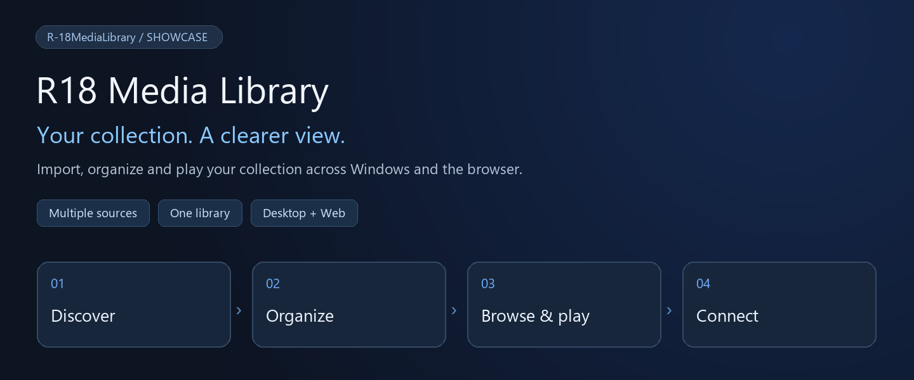

# R18 Media Library · Showcase

[简体中文](系统展示.md) · [日本語](系统展示.ja.md) · **English**



> Bring scattered works into one collection. Organize on Windows and browse from your browser.

[Get started](#get-started) · [Interface tour](#interface-tour) · [Supported sources](#supported-sources) · [User manual](使用手册.en.md)

## At a glance

| 📚 An organized collection | 🎧 Browse and play | 🌐 Access across devices |
| --- | --- | --- |
| Multiple libraries and folders, with circles, tags, formats and favorites to organize your works. | Image viewing, audio and video queues, and a sleep timer. Details and files stay together. | The Windows app and Web interface share works, tasks and settings. Connect from your phone, too. |

| 🔎 Search by source | ⬇️ Visible download progress | 👁 Follow creator updates |
| --- | --- | --- |
| Switch sources from one search toolbar and inspect work or post details. | Manage link resolution, downloads, retries and extraction, with file-level error details. | Check FANBOX archive creators periodically and queue new posts for a chosen library. |

## Interface tour

### 01 / Libraries: the front door to your collection


**Library → works or circles → details and files.** Link multiple folders to each library and choose its default view. Cards show the current collection size.

### 02 / Categories: another way to find a work


Browse by **tags, circles, formats or favorites**. Set circle display names and homepages, mark works as read, save favorites or move a work to another library.

### 03 / Search: start with a source


Source selection, query input and search live in one toolbar. Accepted queries vary by source: work IDs, circle links, creator names, tags or gallery URLs.

### 04 / Downloads: from queue to collection


**Choose a library → queue a work → download and extract → browse locally.** Pause, resolve links again, inspect per-file progress and view download history. Debrid-Link usage is available for relay downloads.

### 05 / Creator monitoring: keep up with new posts


Add a creator from an archive profile, then set the interval, pause checks or run a check immediately. Choose whether to queue existing posts or follow only new ones.

### 06 / Library settings: connect files to your collection


Manage the name, default view, source folders and metadata scans together. Update folder associations after moving your files to a new drive.

## Supported sources

| Source | Discovery and retrieval | Preparation |
| --- | --- | --- |
| DLsite / Anime-sharing | Work or circle IDs and links; forum link resolution and multipart combinations | Valid Debrid-Link key, supported hosts and available quota |
| asmr.one | Desktop direct-download entry for SOU works | Account and desktop source settings |
| FANBOX archive | Creator name, ID or pawchive creator URL | Access to the archive service |
| Official FANBOX | Official source added after login | Valid session and permission to access the content |
| E-Hentai / ExHentai | Keywords, tags or gallery URL | Login and site configuration as required |
| pixiv | Keywords, tags, artwork IDs or URLs | Login and search-category settings as required |

Downloaded works join the same media library, so local files can be managed together.

## Desktop and Web: how they work together

| Windows host | Browser / phone |
| --- | --- |
| Stores the database and files; runs scans, downloads, extraction and background monitoring. | Connects to the host to browse works, inspect queues and change available settings. |
| Local playback through LibVLC / NAudio; source, external-access and SSO configuration. | Image and compatible audio/video playback, plus remote game streaming. |

**Where things run matters:** Web paths, download destinations and “local run” all refer to the Windows host. Keep the app running. Web playback depends on browser codec support; the dedicated asmr.one direct-download entry is currently desktop-only.

## Get started

| ① Launch | ② Create | ③ Import | ④ Explore |
| --- | --- | --- | --- |
| Windows + .NET 10; run `start.bat` | Add a library and a host folder in settings | Scan immediate work subfolders and fetch metadata | View images, play media and save favorites |

```powershell
dotnet run --project src/R-18MediaLibrary.csproj
```

For phone access, enable external access in desktop settings and open `http://<host-address>:<port>/`. The default port is 8080.

[Full user manual →](使用手册.en.md) · [Build and configuration →](README.en.md)

<details>
<summary>Implementation scope and screenshot notes</summary>

- These are real Edge Web screenshots with Simplified Chinese UI. This showcase is available in Chinese, Japanese and English; screenshots remain unaltered in language. The app offers Simplified Chinese, Traditional Chinese, Japanese and English options; translation coverage depends on the interface implementation.
- Counts, library names, creators and paths reflect an existing installation, not default settings. Some screenshots are cropped to emphasize controls.
- Based on the repository and screenshots checked on 2026-10-26. Downloads, login, deletion and streaming were not execution-tested while preparing the documentation.
- Image translation currently has settings and model-dependency management, without a connected translation execution entry.
- Portal deployment under a subpath requires matching root-path API and WebSocket forwarding.
- Deleting a work deletes its files. Scans also prune records of works whose folder is missing under a reachable library root (unreachable drives are skipped), so restore temporarily moved or renamed work folders before scanning.

</details>
