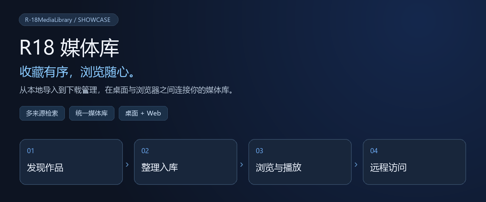

# R18 媒体库 · 系统展示

**简体中文** · [日本語](系统展示.ja.md) · [English](系统展示.en.md)



> 把分散的作品收进同一套媒体库，在 Windows 上整理，在浏览器中随时浏览。

[开始使用](#开始使用) · [界面导览](#界面导览) · [来源支持](#来源支持) · [使用手册](使用手册.md)

## 一眼了解

| 📚 收藏有序 | 🎧 打开就看 | 🌐 多端浏览 |
| --- | --- | --- |
| 多个媒体库、多个磁盘目录，以社团、标签、形式和收藏整理作品。 | 图片大图浏览、音视频播放队列、睡眠定时，文件与介绍集中呈现。 | Windows 桌面与 Web 共用作品、任务和配置，手机也可连接主机浏览。 |

| 🔎 多来源发现 | ⬇️ 下载进度可见 | 👁 作家更新追踪 |
| --- | --- | --- |
| 在统一搜索入口切换来源，查看作品和投稿详情。 | 解析、下载、重试与解压集中管理，失败可展开查看原因。 | 定时检查 FANBOX 归档作家，新投稿按指定目标加入队列。 |

## 界面导览

### 01 / 媒体库：先找到你的收藏


**多库入口 → 作品或社团 → 作品详情与文件。** 每个库可关联多个目录，自由选择默认显示方式；首页卡片直接呈现作品数量。

### 02 / 分类浏览：换一种方式寻找作品


按**作品标签、作品社团、作品形式、我的收藏**切换浏览视角。社团可配置显示别名和主页，作品可标记已读、收藏或移动到其他库。

### 03 / 搜索入口：按来源开始


来源下拉、查询输入与查询按钮位于同一条工具栏。不同来源支持不同输入，例如作品号、社团链接、作家名、标签或画廊地址。

### 04 / 下载管理：从入队到完成


**选择目标库 → 加入队列 → 下载与解压 → 返回媒体库。** 支持暂停、重新解析、文件级进度和下载历史；Debrid-Link 来源可查看用量。

### 05 / 作家监控：跟进后续投稿


从归档作家主页添加监控，在此调整轮询间隔、暂停或立即检查。添加时可选择下载现有投稿，或只跟踪新作品。

### 06 / 单库设置：让目录对应到收藏


库名、默认视图、数据源目录和元数据扫描集中在同一窗口。文件已换盘时，可编辑路径更新关联。

## 来源支持

| 来源 | 发现方式 | 使用前准备 |
| --- | --- | --- |
| DLsite / Anime-sharing | 作品号、社团号或链接；论坛来源解析与分卷组合 | 有效 Debrid-Link Key、可用网盘与额度 |
| asmr.one | 桌面端 SOU 作品直链入口 | asmr.one 账号与桌面来源设置 |
| FANBOX 归档 | 作家名、ID 或 pawchive 作家链接 | 归档服务可访问 |
| FANBOX 官方 | 登录后显示的官方来源 | 有效登录，拥有对应内容权限 |
| E-Hentai / ExHentai | 关键字、标签或画廊链接 | 按内容要求配置登录与站点 |
| pixiv | 关键字、标签、作品号或链接 | 按内容要求配置登录与分级 |

下载后统一进入媒体库，不需要在各来源之间分别管理本地文件。

## 桌面与 Web，如何配合

| Windows 主机 | 浏览器 / 手机 |
| --- | --- |
| 保存数据库与作品，执行扫描、下载、解压和后台监控。 | 连接主机，浏览同一批作品、查看队列、调整可用配置。 |
| LibVLC / NAudio 本地播放；配置来源、外部访问与 SSO。 | 浏览器播放图片与兼容音视频；支持游戏远程串流。 |

**运行位置要分清：** 网页路径、下载目录和“本机运行”都指向服务端 Windows。主程序必须保持运行。Web 音视频格式支持由浏览器决定；asmr.one 专用直链入口目前在桌面端。

## 开始使用

| ① 启动 | ② 建库 | ③ 导入 | ④ 浏览 |
| --- | --- | --- | --- |
| Windows + .NET 10，运行 `start.bat` | 在系统设置添加库与主机目录 | 扫描一级作品子目录并补全元数据 | 打开作品，看图、播放或收藏 |

```powershell
dotnet run --project src/R-18MediaLibrary.csproj
```

需要手机访问时，在桌面“系统设置 → 外部访问”开启服务，浏览器打开 `http://<主机地址>:<端口>/`，默认端口 8080。

[查看完整操作手册 →](使用手册.md) · [查看构建与配置 →](../README.md)

<details>
<summary>实现范围与界面说明</summary>

- 以上为真实 Edge Web 截图，界面为简体中文；本展示页提供中、日、英三版，截图保持原貌，没有把翻译后的图片当作实际界面。应用提供简体中文、繁体中文、日文和英文语言选项，具体文案覆盖以相应界面为准。
- 截图数量、库名、作家与路径是示例实例，不代表默认配置；部分截图裁切以突出操作区。
- 展示依据 2026-10-26 仓库与现有截图，下载、登录、删除及串流未在文档编写中执行测试。
- 图片翻译目前仅有设置与模型依赖管理，尚未接入实际翻译执行入口。
- 门户子路径部署需要配套根路径 API 与 WebSocket 转发；首页可打开不代表串流已验证。
- “删除作品”会删除实际文件；扫描会清理可访问根目录下已不存在的作品记录（整盘不可达时跳过），作品文件夹临时搬走或改名时先恢复再扫描。操作影响详见使用手册。

</details>
