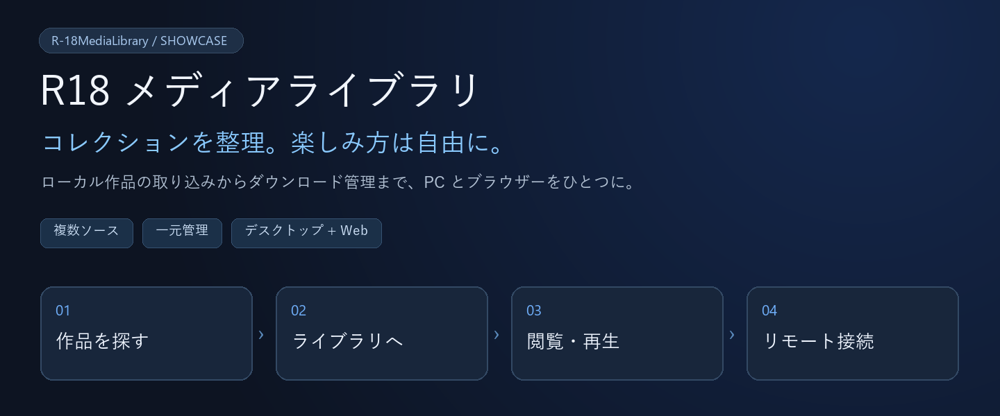

# R18 メディアライブラリ · システム紹介

[简体中文](系统展示.md) · **日本語** · [English](系统展示.en.md)



> 分散している作品をひとつのライブラリへ。Windows で整理し、ブラウザーからも閲覧できます。

[はじめに](#はじめに) · [画面ガイド](#画面ガイド) · [対応ソース](#対応ソース) · [操作マニュアル（中国語）](docs/使用手册.md)

## 主な機能

| 📚 コレクション整理 | 🎧 閲覧・再生 | 🌐 複数端末からアクセス |
| --- | --- | --- |
| 複数ライブラリと保存先に対応。サークル、タグ、作品形式、お気に入りで整理。 | 画像ビューアー、音声・動画キュー、スリープタイマー。作品情報とファイルをまとめて表示。 | Windows アプリと Web で作品・タスク・設定を共有。スマートフォンからも接続可能。 |

| 🔎 ソース別の検索 | ⬇️ ダウンロード管理 | 👁 クリエイターの更新確認 |
| --- | --- | --- |
| 共通の検索画面からソースを切り替え、作品や投稿の詳細を確認。 | リンク解析、ダウンロード、再試行、展開をまとめて管理。エラーの詳細も確認可能。 | FANBOX アーカイブを定期確認し、新規投稿を指定先のダウンロードキューへ追加。 |

## 画面ガイド

### 01 / ライブラリ：コレクションの入口


**ライブラリ → 作品またはサークル → 詳細とファイル。** ひとつのライブラリに複数フォルダーを登録でき、最初に表示する形式も選べます。

### 02 / 分類：別の切り口で探す


**タグ・サークル・作品形式・お気に入り**で閲覧できます。サークルの表示名やホームページを設定し、作品を既読・お気に入りにしたり、別ライブラリへ移動したりできます。

### 03 / 検索：ソースを選んで開始


ソース選択、入力欄、検索ボタンをひとつのツールバーに配置。作品番号、サークルのリンク、作家名、タグ、ギャラリー URL など、ソースに応じた入力に対応します。

### 04 / ダウンロード：キューから完了まで


**保存先を選択 → キューへ追加 → ダウンロード・展開 → ライブラリへ。** 一時停止、再解析、ファイル単位の進捗、履歴を確認できます。Debrid-Link の利用量表示にも対応します。

### 05 / 更新確認：新しい投稿を追う


アーカイブ側の作家ページから登録し、確認間隔の変更、一時停止、手動確認ができます。登録時に既存投稿も取得するか、今後の新規投稿だけを追うか選べます。

### 06 / ライブラリ設定：保存場所を管理


名前、初期表示、保存先、メタデータのスキャンをひとつの画面に集約。データ移行後はフォルダーパスの関連付けを更新できます。

## 対応ソース

| ソース | 検索・取得方法 | 事前準備 |
| --- | --- | --- |
| DLsite / Anime-sharing | 作品・サークル番号やリンク、掲示板リンク解析、分割ファイルの組み合わせ | 有効な Debrid-Link Key、対応ホストと利用枠 |
| asmr.one | デスクトップ版の SOU 作品向け直接ダウンロード | アカウントとデスクトップ側のソース設定 |
| FANBOX アーカイブ | 作家名、ID、pawchive の作家リンク | アーカイブサービスへの接続 |
| FANBOX 公式 | ログイン後に追加される公式ソース | 有効なログインと対象コンテンツの閲覧権限 |
| E-Hentai / ExHentai | キーワード、タグ、ギャラリー URL | 必要に応じたログインとサイト設定 |
| pixiv | キーワード、タグ、作品 ID、URL | 必要に応じたログインと検索区分の設定 |

取得した作品は共通ライブラリで管理できます。

## デスクトップ版と Web の役割

| Windows ホスト | ブラウザー / スマートフォン |
| --- | --- |
| データベースと作品を保存し、スキャン・取得・展開・更新確認を実行。 | ホストに接続し、同じ作品やキューを閲覧。公開されている設定を変更。 |
| LibVLC / NAudio によるローカル再生。ソース、外部アクセス、SSO の設定。 | 画像と対応する音声・動画を再生。ゲームのリモートストリーミングにも対応。 |

**実行場所に注意：** Web で指定するパス、保存先、「ローカル実行」はすべて Windows ホスト側を指します。アプリを起動したままにする必要があります。Web の再生形式はブラウザーに依存し、asmr.one 専用の直接取得入口は現在デスクトップ版にあります。

## はじめに

| ① 起動 | ② ライブラリ作成 | ③ 取り込み | ④ 閲覧 |
| --- | --- | --- | --- |
| Windows + .NET 10、`start.bat` を実行 | 設定からライブラリとホスト上のフォルダーを追加 | 直下の作品フォルダーをスキャンし、メタデータを取得 | 画像・再生・お気に入りを利用 |

```powershell
dotnet run --project src/R-18MediaLibrary.csproj
```

スマートフォンで利用する場合は、デスクトップ版の外部アクセスを有効にし、`http://<ホストアドレス>:<ポート>/` を開きます。既定ポートは 8080 です。

[操作マニュアル（中国語）→](docs/使用手册.md) · [ビルドと設定（中国語）→](README.md)

<details>
<summary>実装範囲と画面について</summary>

- スクリーンショットは実際の Edge Web 画面で、UI は簡体字中国語です。紹介ページは中国語・日本語・英語の 3 版を用意しています。画面の文字を加工して日本語 UI として紹介しているわけではありません。アプリには簡体字中国語、繁体字中国語、日本語、英語の選択肢があり、翻訳範囲は各画面の実装に依存します。
- 件数、名前、作家、パスは既存環境の例です。一部画像は操作部分を切り抜いています。
- 2026-10-26 時点のソースと画像に基づきます。文書作成中に取得、ログイン、削除、ストリーミングの実行テストは行っていません。
- 画像翻訳は設定とモデル依存ファイルの管理までで、実際の翻訳実行入口は未接続です。
- サブパス経由のポータル公開にはルート API と WebSocket の転送設定が必要です。
- 作品削除は実ファイルも削除します。スキャンは見つからない作品の記録を整理するため、データドライブを接続してから実行してください。

</details>
